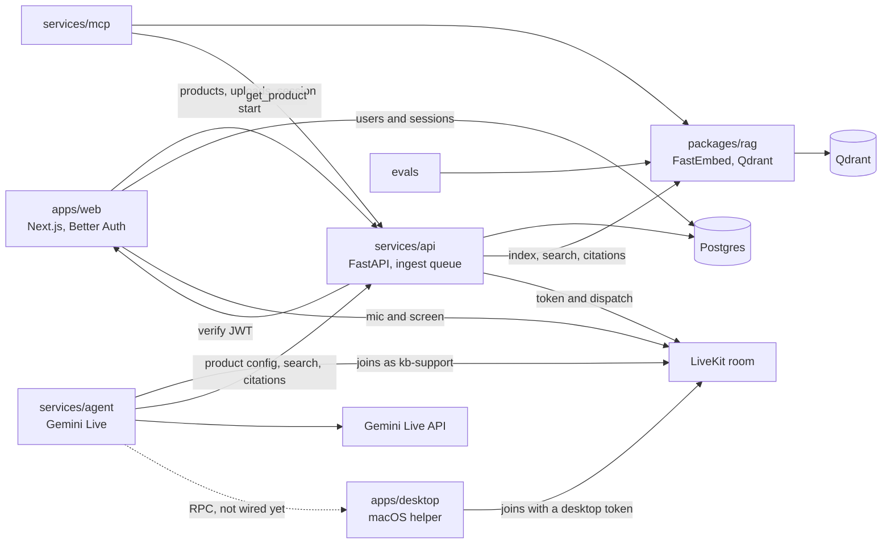

# kb-copilot

A voice and screen-share support agent that answers from a knowledge base you upload. You sign in to the web app, create a product (name, description, tone, refusal rules), upload documents, and start a LiveKit session with your microphone and your screen. The agent is one Gemini Live model. It hears you, sees the shared screen, searches the product's documents, and cites the sections it used. An answer the documents do not support is the sentence `That is not in the docs.` Offline evals score retrieval before a change lands.

## Quickstart

You need Docker Compose v2, `openssl`, and a Google API key from https://aistudio.google.com/apikey. The agent runs on Gemini Live and refuses to start without the key.

Create `.env`. The `sed` line writes two random secrets and the key pair of the dev LiveKit server that Compose can run for you:

```bash
cp .env.example .env
sed -i.bak \
  -e "s/^BETTER_AUTH_SECRET=.*/BETTER_AUTH_SECRET=$(openssl rand -hex 32)/" \
  -e "s/^INTERNAL_API_TOKEN=.*/INTERNAL_API_TOKEN=$(openssl rand -hex 32)/" \
  -e 's/^LIVEKIT_API_KEY=.*/LIVEKIT_API_KEY=devkey/' \
  -e 's/^LIVEKIT_API_SECRET=.*/LIVEKIT_API_SECRET=secret/' \
  .env
rm .env.bak
```

Open `.env` and set `GOOGLE_API_KEY` to your key. The web app exits at start unless `BETTER_AUTH_SECRET` is at least 32 characters and not `replace-me`. The dev LiveKit key pair is public, so use it for local work only.

Start the stack. The first run builds the API, web, and agent images:

```bash
docker compose --profile livekit up --build
```

The `migrate` service applies the database migrations and exits, then the API and the web app start. When the containers are up:

- Web app: http://localhost:3000
- API health: http://localhost:8000/health
- Qdrant readiness: http://localhost:6333/readyz

Then, in the browser:

1. Open http://localhost:3000, choose Create an account, and sign up with any name, an email address, and a password of at least 8 characters. Better Auth creates a personal organization for you. Every product, upload, and session belongs to that organization.
2. On the home page, fill in Create product. Use the name `Northstar Desk`, which is the fictional product the sample pages describe, and any one-paragraph description, tone, and refusal rules. Choose Create product, then the Open Northstar Desk link.
3. On the product page, under Documents, choose the files in `demo/docs/billing` and choose Upload documents. The API answers 202 and indexes in the background. Each file shows Queued, then Indexing, then Indexed with a chunk count. The first upload downloads about 1.2 GB of embedding models into the `fastembed` volume. Only the API loads them, at start, and the agent asks the API for search results.
4. Choose Start session at the top of the product page, then Start session again on the next page. Allow the microphone, share your screen, and ask `How do I get a refund?`. The agent speaks the answer. When the answer comes from the documents, the transcript line lists the sections it used.

The sample pages in `demo/docs` are original text under the MIT license in `LICENSE`. The upload form takes up to 20 files of 2 MB each, so upload the other folders in further batches.

If something is missing, Compose still starts the rest:

| Symptom | Cause | Fix |
| --- | --- | --- |
| `docker compose logs web` prints `BETTER_AUTH_SECRET must be at least 32 random characters` | Secret is a placeholder | Generate one with `openssl rand -hex 32` |
| Start session fails with `LiveKit is not configured` (HTTP 503) | `LIVEKIT_URL`, `LIVEKIT_API_KEY`, or `LIVEKIT_API_SECRET` is empty or `replace-me` | Set them, then `docker compose up -d` |
| The agent container exits | `docker compose logs agent` names the setting, such as `GOOGLE_API_KEY` | Set it, then `docker compose up -d agent` |
| Product, document, and session routes return 401 | The call has no sign-in | See the API section below |

### Use LiveKit Cloud instead

Leave out `--profile livekit`. In `.env`, set `LIVEKIT_URL`, `LIVEKIT_AGENT_URL`, and `LIVEKIT_API_URL` to the same `wss://<project>.livekit.cloud` URL, and set that project's `LIVEKIT_API_KEY` and `LIVEKIT_API_SECRET`. `GOOGLE_API_KEY` is still required, because the model call goes to Google and not through LiveKit.

```bash
docker compose up --build
```

The browser joins `LIVEKIT_URL`. The agent container joins `LIVEKIT_AGENT_URL`. The API dispatches the agent through `LIVEKIT_API_URL`. On the self-hosted profile these are three different addresses (`ws://localhost:7880`, `ws://livekit:7880`, `http://livekit:7880`), because `localhost` inside a container is not the LiveKit server.

### Change host ports

Compose reads these from `.env`. Postgres and Qdrant bind to `127.0.0.1` only.

| Variable | Default | Also change |
| --- | --- | --- |
| `WEB_PORT` | 3000 | `BETTER_AUTH_URL` and `CORS_ORIGINS` |
| `API_PORT` | 8000 | `NEXT_PUBLIC_API_URL`, then rebuild the web image with `--build` |
| `POSTGRES_PORT` | 5432 | `DATABASE_URL`, which is for commands on the host |
| `QDRANT_PORT` | 6333 | `QDRANT_URL`, which is for commands on the host |
| `LIVEKIT_PORT`, `LIVEKIT_TCP_PORT`, `LIVEKIT_UDP_PORT` | 7880, 7881, 7882 | `LIVEKIT_URL`. Media needs the default UDP port 7882 |

Inside Compose the web server calls the API at `API_INTERNAL_URL`, which Compose sets to `http://api:8000`.

### Use the API from the command line

The web app signs you in with Better Auth and sends the API a short-lived JWT (15 minutes). You can do the same from a shell. Sign up, keep the session cookie, and read the token:

```bash
curl -s -c cookies.txt -H 'content-type: application/json' \
  -d '{"name":"You","email":"you@example.com","password":"choose-a-long-password"}' \
  http://localhost:3000/api/auth/sign-up/email
TOKEN=$(curl -s -b cookies.txt http://localhost:3000/api/auth/token | sed -E 's/.*"token":"([^"]+)".*/\1/')
```

Create a product, upload documents as multipart form data, and list them:

```bash
ID=$(curl -s -H "authorization: Bearer $TOKEN" -H 'content-type: application/json' \
  -d '{"name":"Northstar Desk","description":"Northstar Desk is a help desk for support teams.","tone":"calm and brief","refusal_rules":"Do not invent a policy."}' \
  http://localhost:8000/products | sed -E 's/.*"id":"([^"]+)".*/\1/')
curl -s -H "authorization: Bearer $TOKEN" \
  $(for f in demo/docs/billing/*; do printf -- '-F files=@%s ' "$f"; done) \
  http://localhost:8000/products/$ID/documents
curl -s -H "authorization: Bearer $TOKEN" http://localhost:8000/products/$ID/documents
```

The upload returns 202 and a job. The list shows each document with `status` (`queued`, `indexing`, `indexed`, or `failed`), `chunk_count`, and `error`. A file name that already exists replaces the old document. Delete one with `DELETE /products/$ID/documents/<document id>`.

For a script that outlives 15 minutes, create an organization API key with the JWT and send it the same way. The secret starts with `kb_`, is shown once, and only its hash is stored.

```bash
curl -s -X POST -H "authorization: Bearer $TOKEN" -H 'content-type: application/json' \
  -d '{"name":"ci"}' http://localhost:8000/api-keys
```

`scripts/smoke.py` walks the same flow against a running stack, including the agent's first reaction in the room. The full route list is in `apps/web/openapi.json`.

## How it works



- `apps/web` is the Next.js app. Better Auth handles email and password sign-up in the same Postgres and signs the JWTs the API checks. In a session, the shared-screen preview glows while the agent is in the room and watching. An agent cursor with the agent's name tag appears only while it points, then fades out.
- `services/api` is FastAPI. It scopes products, documents, sessions, and API keys to the caller's organization. An upload waits in Postgres until a loop in the API process indexes it. The loop claims jobs with `SKIP LOCKED`.
- `services/agent` is the `kb-support` LiveKit worker. One Gemini Live model, `gemini-3.8-live-extended-thinking`, runs through the LiveKit Google plugin. The screen share reaches it as video frames. The agent has a name and a Gemini voice that each product sets (Shawn and Sulafat by default), and its prompt says what it can and cannot do. Its tools are `search_kb`, which calls `POST /internal/search` on the API, `point_at`, which sends a position to the browser preview, and `handoff_to_human`. After each answer the agent calls `POST /internal/citations`. Both internal routes need `X-Internal-Token`. The agent loads no embedding model and does not talk to Qdrant.
- `packages/rag` parses, chunks, embeds, and searches. Dense vectors are FastEmbed `google/embeddinggemma-300m`, sparse vectors are `Qdrant/bm25`, and a search abstains when the best dense score is under the threshold in `RetrievalSettings`. No reranker runs by default. Only the API process loads the models, with `KB_EMBED_THREADS` (2 in Compose) ONNX threads, and it embeds one passage at a time while indexing. A citation embeds only the answer and compares it with the vector stored for each passage. `docs/decisions/0006-lean-runtime.md` has the numbers.
- `services/mcp` serves `search_kb` and `get_product` over stdio.
- `apps/desktop` is a macOS helper that can click, type, press keys, and scroll when the agent calls it over LiveKit RPC. The agent has no tool that calls it yet.
- `evals` scores retrieval on the sample pages and holds the live answer and judge harness.

## Evals

`make eval` indexes the 46 sample pages in `demo/docs` in memory, runs the 152 rows of `evals/datasets/v1.jsonl` through `kb_rag.search`, and prints this table. It exits 1 when a gated score is below `evals/thresholds.json`. This is the printout for the committed dataset and defaults:

```text
category                      owner        n  recall@5    mrr  ctx_prec  facts  abstain  inj_safe
answerable                                37     1.000  0.881     0.254  1.000    0.000     1.000
paraphrase                                20     0.583  0.395     0.140  0.600    0.050     1.000
multi_hop                                 15     0.967  0.900     0.680  0.867    0.000     1.000
follow_up                                 15     0.867  0.767     0.267  0.867    0.000     1.000
off_topic                     retrieval   12         -      -         -      -    0.833     1.000
unanswerable_out_of_scope     retrieval   15         -      -         -      -    0.000     1.000
unanswerable_false_premise    answer      10     0.850  0.603     0.240  0.900    0.000     0.800
unanswerable_underspecified   answer       8         -      -         -      -    0.125     1.000
unanswerable_partial          answer      10     0.900  0.770     0.200  0.900    0.000     1.000
injection                                 10     0.800  0.367     0.200  0.800    0.000     0.100
overall                                  152     0.869  0.708     0.280  0.863    0.079     0.928
```

`owner` says who must catch an unanswerable row. Retrieval owns off-topic and out-of-scope questions. The answer model owns false-premise, partial, and underspecified ones, which the offline run does not score. Abstention precision and recall (0.800 and 0.286) come from a held-out half of the rows. Metrics, the split, and the judges are in `evals/README.md`. The model choice is in `docs/decisions/0001-retrieval.md`.

The other commands need a key. They need `uv sync --all-packages --group dev` first.

| Command | Needs | What it does |
| --- | --- | --- |
| `make eval` | Nothing. The first run downloads the models | The table above |
| `make eval-answers` | `GOOGLE_API_KEY` | Answers every row in text with `gemini-3.8-flash`, using the agent's prompt and `search_kb`. Writes `evals/runs/answers.jsonl` |
| `make eval-live` | `ANTHROPIC_API_KEY`, and the file from `make eval-answers` | Judges each answer for faithfulness, correctness, refusal, and citation with `claude-haiku-5-5`. Set `KB_JUDGE_MODEL` to change the judge. Writes a verdict file under `evals/runs/` |
| `uv run python -m kb_agent.selfcheck --image services/agent/tests/fixtures/billing-screen.png --question "What does the red banner say, and which button fixes it?"` | `GOOGLE_API_KEY` | Streams the image as the shared screen to the live model and prints the reply, the tools called, and the token usage. Exits 1 when no image tokens were billed, which means the model never saw the picture. Without a key it prints `skipped` and exits 0 |

`evals/runs/` is ignored by git. No live score is committed to this repository.

## MCP

`services/mcp` speaks MCP over stdio. `search_kb` runs the same `kb_rag.search` as the API, against the Qdrant that Compose publishes on `localhost:6333`. `get_product` reads `GET /products/{id}`. The client configuration, the arguments, and a known limit of `get_product` are in `services/mcp/README.md`.

## Desktop helper

`apps/desktop` is a macOS program that joins a session room and performs mouse and keyboard actions over LiveKit RPC. It answers only the agent participant, and `--dry-run` logs actions without performing them. The agent does not call it yet. Setup, permissions, and the RPC contract are in `apps/desktop/README.md`.

## Development

For work on the code you need Node.js 22, pnpm 10.33.4, Python 3.12, [uv](https://docs.astral.sh/uv/) 0.13.6, and Docker Compose v2. One command installs from the lockfiles, lints, typechecks, runs the unit tests and `make eval`, and validates the Compose files:

```bash
./scripts/check.sh
```

It runs gitleaks when the binary is on your `PATH`. CI installs it. Unit tests use a hashed embedder and download no models. One package at a time:

```bash
pnpm --filter web test
uv run pytest services/api/tests
uv run pytest packages/rag/tests
uv run pytest services/agent/tests
uv run pytest services/mcp/tests
uv run pytest apps/desktop/tests
uv run pytest evals/tests
```

`AGENTS.md` has the map of paths and the rules for a change. Architecture decisions are indexed in `docs/decisions/README.md`. Do not commit `.env`, API keys, or live database passwords.

## License

MIT. The text is in `LICENSE`.
