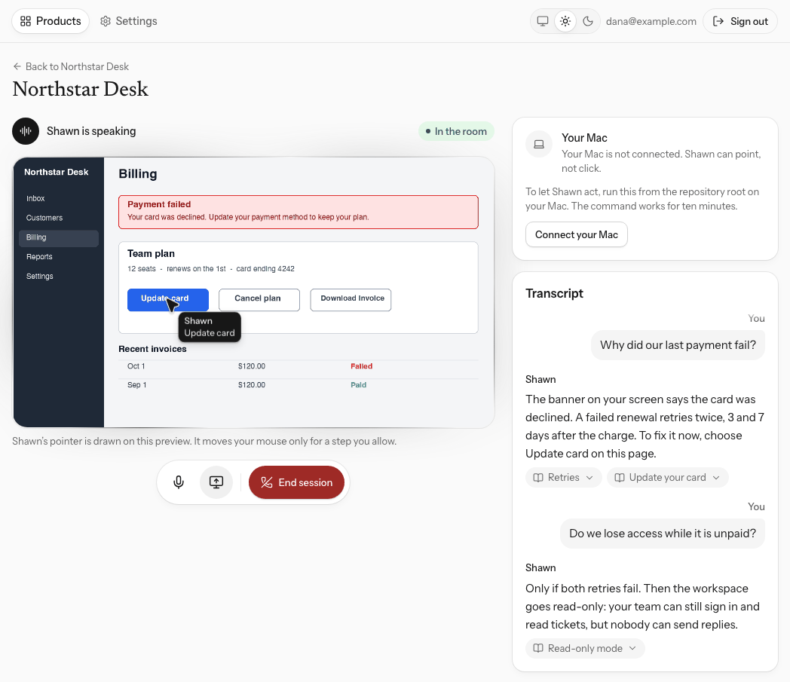
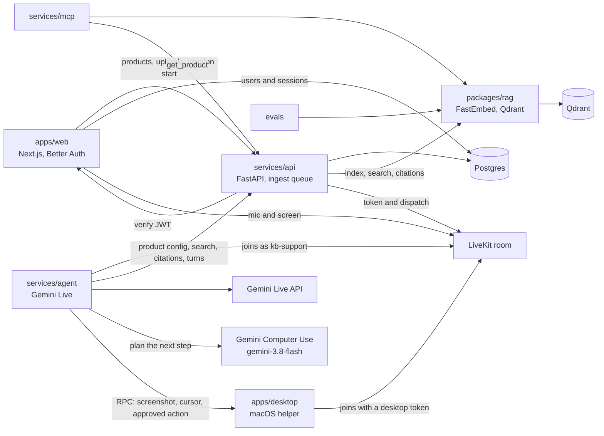
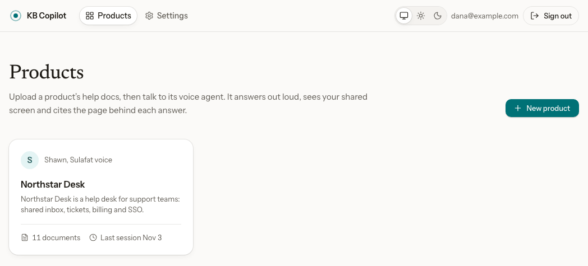
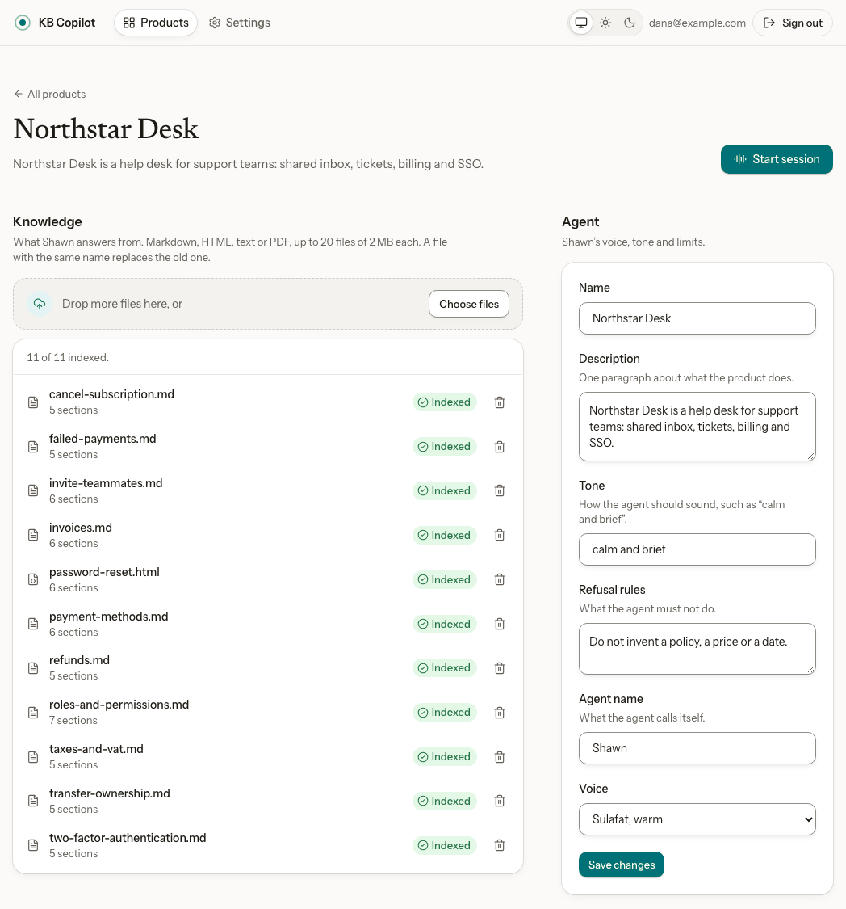
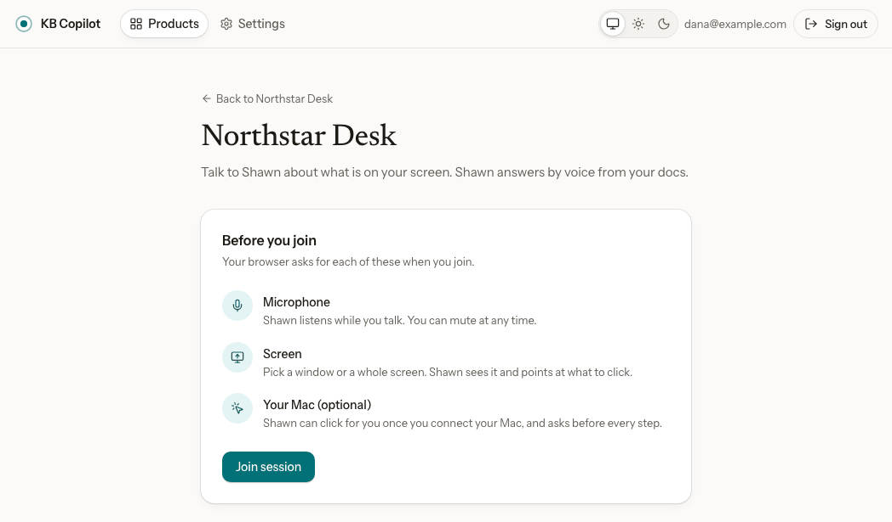
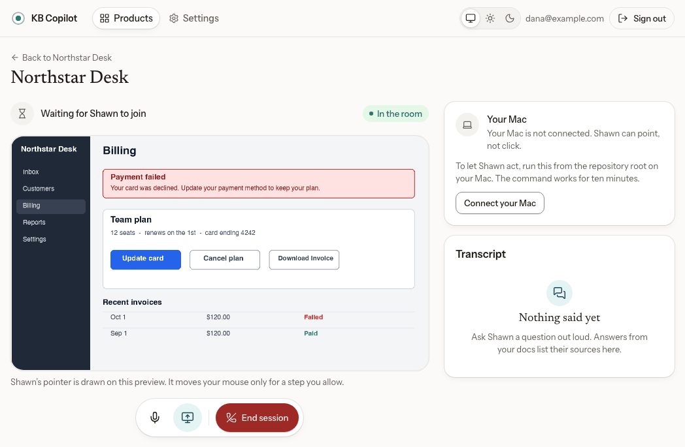
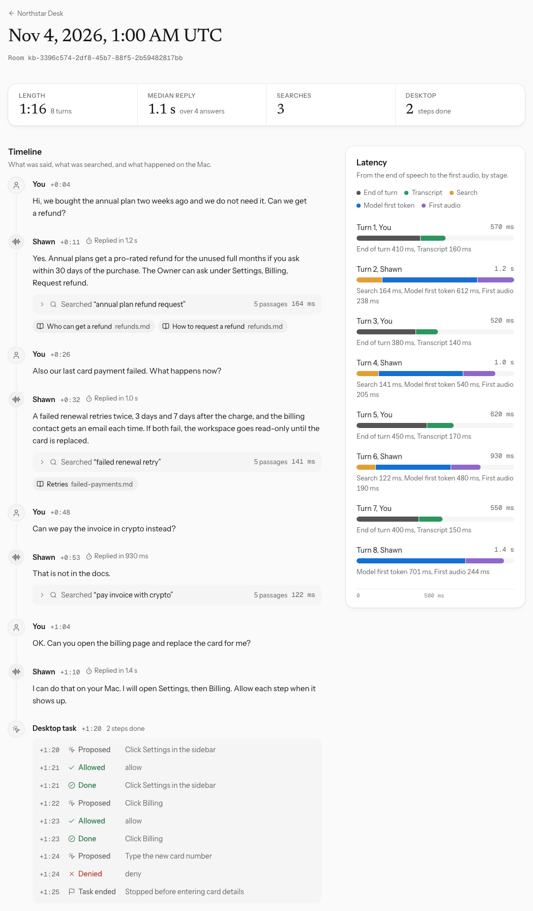
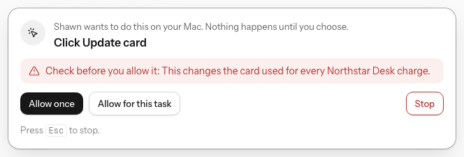

# kb-copilot

A voice and screen-share support agent that answers from a knowledge base you upload, and acts on your Mac only one approved step at a time.



*Sample session. The page is the real session page; the transcript, citations and pointer are fixture data.*

## What you can do

- Create a product, give its agent a name, a voice, a tone and refusal rules, and upload its help docs (Markdown, HTML, text or PDF).
- Start a session, share your screen and ask out loud. The agent searches the docs, answers by voice, and shows the sections it used under each answer. When the docs don't cover a question it says `That is not in the docs.`
- Let it point at a control on your shared screen, or connect your Mac and let it click and type for you, with your approval for every step.
- Hand a problem to a person as a Linear issue, which is created only after you approve it.
- Replay any session afterwards: what was said, what each search returned, what was cited, and how long each stage took.
- Search the same knowledge base from an MCP client.

## How it works



- `apps/web` is the Next.js app. Better Auth handles email and password sign-up in the same Postgres and signs the JWTs the API checks. In a session the shared screen is the main stage, and it glows while the agent is in the room and watching. An agent cursor with the agent's name tag appears only while it points, then fades out. When the agent wants to act on your Mac, an approval tray shows the step and the cursor rings at its target until you decide.
- `services/api` is FastAPI. It scopes products, documents, sessions and API keys to the caller's organization. An upload waits in Postgres until a loop in the API process indexes it. The loop claims jobs with `SKIP LOCKED`.
- `services/agent` is the `kb-support` LiveKit worker. One Gemini Live model, `gemini-3.8-live-extended-thinking`, runs through the LiveKit Google plugin, and the screen share reaches it as video frames. Each product sets the agent's name and Gemini voice (Shawn and Sulafat by default), and its prompt says what it can and cannot do. Its tools are `search_kb`, which calls `POST /internal/search` on the API, `point_at`, which sends a position to the browser preview, `handoff_to_human`, and `operate_computer`, which works through the desktop helper one approved step at a time. After each answer the agent calls `POST /internal/citations`. Both internal routes need `X-Internal-Token`. The agent loads no embedding model and does not talk to Qdrant.
- `packages/rag` parses, chunks, embeds and searches. Dense vectors are FastEmbed `google/embeddinggemma-300m`, sparse vectors are `Qdrant/bm25`, and a search abstains when the best dense score is under the threshold in `RetrievalSettings`. No reranker runs by default. Only the API process loads the models, with `KB_EMBED_THREADS` (2 in Compose) ONNX threads, and it embeds one passage at a time while indexing. A citation embeds only the answer and compares it with the vector stored for each passage.
- `services/mcp` serves `search_kb` and `get_product` over stdio.
- `apps/desktop` is a macOS helper. Over LiveKit RPC it sends the agent screenshots, draws the agent's cursor on the real screen, and clicks, types, presses keys and scrolls for the steps you allow.
- `evals` scores retrieval on the sample pages and holds the live answer and judge harness.

The full design, with the request flow for one spoken question and the security boundaries, is in [docs/design.md](docs/design.md). What broke along the way and how it was measured is in [docs/case-study.md](docs/case-study.md).

## Quickstart

You need Docker Compose v2, `openssl`, and a Google API key from https://aistudio.google.com/apikey. The agent runs on Gemini Live and refuses to start without the key.

Create `.env`. The `sed` line writes two random secrets and the key pair of the dev LiveKit server that Compose can run for you:

```bash
cp .env.example .env
sed -i.bak \
  -e "s/^BETTER_AUTH_SECRET=.*/BETTER_AUTH_SECRET=$(openssl rand -hex 32)/" \
  -e "s/^INTERNAL_API_TOKEN=.*/INTERNAL_API_TOKEN=$(openssl rand -hex 32)/" \
  -e 's/^LIVEKIT_API_KEY=.*/LIVEKIT_API_KEY=devkey/' \
  -e 's/^LIVEKIT_API_SECRET=.*/LIVEKIT_API_SECRET=secret/' \
  .env
rm .env.bak
```

Open `.env` and set `GOOGLE_API_KEY` to your key. The web app exits at start unless `BETTER_AUTH_SECRET` is at least 32 characters and not `replace-me`. The dev LiveKit key pair is public, so use it for local work only.

Start the stack. The first run builds the API, web and agent images:

```bash
docker compose --profile livekit up --build
```

The `migrate` service applies the database migrations and exits, then the API and the web app start. On its first start the API downloads about 1.2 GB of embedding models into the `fastembed` volume, in the background. When the containers are up:

- Web app: http://localhost:3000
- API health: http://localhost:8000/health
- Qdrant readiness: http://localhost:6333/readyz

Then, in the browser:

1. Open http://localhost:3000, choose Create an account, and sign up with any name, an email address, and a password of at least 8 characters. Better Auth creates a personal organization for you. Every product, upload and session belongs to it.
2. Choose New product. Use the name `Northstar Desk`, which is the fictional product the sample pages describe, and any one-paragraph description, tone and refusal rules. Choose Create product, and the product page opens.
3. Under Knowledge, choose the files in `demo/docs/billing` (or drop them on the box), then choose Upload. The API answers 202 and indexes in the background. Each file shows Queued, then Indexing, then Indexed with its number of sections.
4. Choose Start session. The join check says what the browser will ask for. Choose Join session, allow the microphone, and share your screen. Ask `How do I get a refund?`. The agent speaks the answer, and when the answer comes from the documents the transcript line lists the sections it used.

| Products | Knowledge |
| --- | --- |
|  |  |

| Join check | In the room |
| --- | --- |
|  |  |

*These four come from a fresh local stack. In the room, the shared screen is the billing test fixture in `services/agent/tests/fixtures`, and the agent had not joined because that run had no Google key.*

The sample pages in `demo/docs` are original text under the MIT license in `LICENSE`. The upload form takes up to 20 files of 2 MB each, so upload the other folders in further batches.

If something is missing, Compose still starts the rest:

| Symptom | Cause | Fix |
| --- | --- | --- |
| `docker compose logs web` prints `BETTER_AUTH_SECRET must be at least 32 random characters` | Secret is a placeholder | Generate one with `openssl rand -hex 32` |
| Start session fails with `LiveKit is not configured` (HTTP 503) | `LIVEKIT_URL`, `LIVEKIT_API_KEY`, or `LIVEKIT_API_SECRET` is empty or `replace-me` | Set them, then `docker compose up -d` |
| The agent container exits | `docker compose logs agent` names the setting, such as `GOOGLE_API_KEY` | Set it, then `docker compose up -d agent` |
| A document shows Failed with "indexing failed" | `docker compose logs api` has the cause. One cause is a full Docker disk, which Qdrant reports as `No space left on device` | Free space, then upload the file again |
| Every upload fails and `docker compose logs api` says `kb_chunks holds 384-dimension vectors` | The search index was built by an older version with a different embedding model | `curl -X DELETE http://localhost:6333/collections/kb_chunks`, then upload the documents again |
| Product, document and session routes return 401 | The call has no sign-in | See [docs/setup.md](docs/setup.md#use-the-api-from-the-command-line) |

[docs/setup.md](docs/setup.md) covers LiveKit Cloud, other host ports, and the API from the command line. `scripts/smoke.py` walks the same flow against a running stack, up to the agent's first reaction in the room. CI runs it on every pull request and every push to `main`.

## Evals

The offline gate scores retrieval on every change, with no model call. The live harness has a model answer every question, and four judges grade the answers.

### Offline retrieval gate

`make eval` indexes the 46 sample pages in `demo/docs` in memory, runs the 152 rows of `evals/datasets/v1.jsonl` through `kb_rag.search`, and prints this table. It exits 1 when a gated score is below `evals/thresholds.json`. This is the printout for the committed dataset and defaults:

```text
category                      owner        n  recall@5    mrr  ctx_prec  facts  abstain  inj_safe
answerable                                37     1.000  0.881     0.254  1.000    0.000     1.000
paraphrase                                20     0.583  0.395     0.140  0.600    0.050     1.000
multi_hop                                 15     0.967  0.900     0.680  0.867    0.000     1.000
follow_up                                 15     0.867  0.767     0.267  0.867    0.000     1.000
off_topic                     retrieval   12         -      -         -      -    0.833     1.000
unanswerable_out_of_scope     retrieval   15         -      -         -      -    0.000     1.000
unanswerable_false_premise    answer      10     0.850  0.603     0.240  0.900    0.000     0.800
unanswerable_underspecified   answer       8         -      -         -      -    0.125     1.000
unanswerable_partial          answer      10     0.900  0.770     0.200  0.900    0.000     1.000
injection                                 10     0.800  0.367     0.200  0.800    0.000     0.100
overall                                  152     0.869  0.708     0.280  0.863    0.079     0.928
```

`owner` says who must catch an unanswerable row. Retrieval owns off-topic and out-of-scope questions. The answer model owns false-premise, partial and underspecified ones, which the offline run does not score. Abstention precision and recall (0.800 and 0.286) come from a held-out half of the rows. Metrics, the split and the judges are in `evals/README.md`. The model choice is in `docs/decisions/0001-retrieval.md`.

### Live answers and judges

152 rows, answered in text by Gemini `gemini-3.8-flash` with the agent's prompt and tools, and judged by `claude-haiku-5-5`. Pass rate per judge, run on 2026-11-03:

| Run | Faithful | Correct | Refusal | Citation |
| --- | --- | --- | --- | --- |
| Before (judge v1) | 0.776 | 0.816 | 0.579 | 0.388 |
| Measurement fixed (judge v2) | 0.928 | 0.822 | 0.836 | 0.553 |
| Prompt fixed | 0.954 | 0.895 | 0.908 | 0.671 |

The second row changes the harness and the judges and leaves the agent alone. The judges grade against the passages the model saw, filler words no longer break citation matching, and every agent tool has a stub. The third row changes only the agent's prompt. Answers with no citation went from 94 to 77 to 68. The story is in [docs/case-study.md](docs/case-study.md), and the per-category tables are in `docs/decisions/0002-evals.md`.

Each row is one run. The judges are not yet calibrated against human labels, so their error rates are unknown, and a difference of one or two rows within a category is noise. `make judge-calibrate` is ready for the labels when they exist.

### Commands that need a key

These need `uv sync --all-packages --group dev` first. `make eval-answers` and `make eval-live` read the keys from the repo `.env`; a value set in the shell wins.

| Command | Needs | What it does |
| --- | --- | --- |
| `make eval` | Nothing. The first run downloads the models | The offline table above |
| `make eval-answers` | `GOOGLE_API_KEY` | Answers every row in text with `gemini-3.8-flash`, using the agent's prompt and tools. Writes `evals/runs/answers.jsonl` with each answer, its citations, and the passages its searches returned |
| `make eval-live` | `ANTHROPIC_API_KEY`, and the file from `make eval-answers` | Judges each answer for faithfulness, correctness, refusal and citation with `claude-haiku-5-5`. Set `KB_JUDGE_MODEL` to change the judge. Writes a verdict file under `evals/runs/` |
| `uv run python -m kb_agent.selfcheck --image services/agent/tests/fixtures/billing-screen.png --question "What does the red banner say, and which button fixes it?"` | `GOOGLE_API_KEY` | Streams the image as the shared screen to the live model and prints the reply, the tools called, and the token usage. Exits 1 when no image tokens were billed, which means the model never saw the picture. Without a key it prints `skipped` and exits 0 |

`evals/runs/` is ignored by git. A full live run takes about 40 minutes.

## Replay and tracing

Every session leaves a replay. Open a product and its Sessions list shows each one with its date, length, turns, desktop actions and handoffs. A replay shows the transcript, and under each answer the searches it ran (query, passages with scores, or no match) and the passages it cited. It also lists the desktop steps you were asked to approve, the handoffs, and a bar of stage latency for each turn: search, model first token, first audio.



*Sample session, seeded data.*

The agent posts each turn to the API as it happens. If the API is down, the turn is dropped and the conversation goes on. The API redacts email addresses, card numbers and phone numbers before it stores anything. `docs/decisions/0007-session-replay.md` has what is stored and for how long.

Traces are optional. Leave `OTEL_EXPORTER_OTLP_ENDPOINT` empty and no tracing code loads. To look at them, start the viewer, point both services at it, and open http://localhost:16686:

```bash
echo 'OTEL_EXPORTER_OTLP_ENDPOINT=http://jaeger:4318' >> .env
docker compose --profile observability up --build
```

Spans carry timings, model names and token counts. They do not carry the conversation.

## Desktop actions

The agent can do a task on your Mac, such as opening a settings page, but only one step at a time and only after you allow each step in the session page. `apps/desktop` is the program on your Mac that does it.

How a task runs:

1. You ask the agent for help. It says what it would do and asks if that is okay.
2. After you say yes, it calls `operate_computer`. The helper sends a screenshot of the main display, and `gemini-3.8-flash` Computer Use plans one step from it and from the product docs.
3. The session page shows the step in an approval tray: Allow once, Allow for this task, or Stop. The agent cursor rings at the target on the preview and on your real screen. Nothing happens until you choose. After a minute without an answer the task stops.
4. On your approval the helper performs the step, the cursor shows a click, and a new screenshot goes back to the model. This repeats until the task is done, you stop it, or ten steps pass.



*Sample session, fixture data.*

The safety model:

- Every step waits for your decision in the page. The agent cannot approve a step itself.
- A step that Gemini flags for confirmation always waits for you, even after Allow for this task, and the tray shows Gemini's explanation. A step Gemini blocks ends the task.
- The agent takes decisions only from the participant who started the session, never from the helper or anyone else in the room.
- The helper answers only the agent participant, validates every payload (coordinates, text length, scroll size, key names), and runs one action at a time. Its token can join only your session's room, sends data only, and lasts ten minutes.
- The prompt tells the agent never to enter a password, pay, or accept terms for you.
- Every proposal, decision and action is written to the audit log. If the API does not record a step, the task stops before it acts.

The helper trusts the agent, so it cannot check on its own that you approved. The approval lives in the agent and the page. Setup, the `--dry-run` first run, macOS permissions and the RPC contract are in `apps/desktop/README.md`. The design is in `docs/decisions/0004-desktop-actions.md`.

## MCP

`services/mcp` speaks MCP over stdio. `search_kb` runs the same `kb_rag.search` as the API, against the Qdrant that Compose publishes on `localhost:6333`. `get_product` reads `GET /products/{id}`. The client configuration and the arguments are in `services/mcp/README.md`.

## Development

For work on the code you need Node.js 22, pnpm 10.33.4, Python 3.12, [uv](https://docs.astral.sh/uv/) 0.13.6, and Docker Compose v2. One command installs from the lockfiles, lints, typechecks, runs the unit tests, builds the web app, runs `make eval`, and validates the Compose files:

```bash
./scripts/check.sh
```

It runs gitleaks when the binary is on your `PATH`. CI installs it. Unit tests use a hashed embedder and download no models. One package at a time:

```bash
pnpm --filter web test
uv run pytest services/api/tests
uv run pytest packages/rag/tests
uv run pytest services/agent/tests
uv run pytest services/mcp/tests
uv run pytest apps/desktop/tests
uv run pytest evals/tests
```

CI runs the same checks, the API tests on Postgres, the offline eval gate, a check that the generated OpenAPI client is current, gitleaks, and the smoke run on a Compose stack with LiveKit. It never calls a paid API.

`AGENTS.md` has the map of paths and the rules for a change. Architecture decisions are indexed in [docs/decisions/README.md](docs/decisions/README.md). Do not commit `.env`, API keys, or live database passwords.

## How this repo is maintained

Some small fixes are drafted by [thin-pr](https://github.com/kocherev/thin-pr-orchestrator). Labelling an issue with a template label such as `thin-pr:bugfix` or `thin-pr:docs` starts a run that plans the change, writes it, runs the repo's checks, and opens a draft pull request with the plan, the check output and a review. The owner reviews and merges each one by hand. Examples: [#35](https://github.com/kocherev/kb-copilot/pull/35) (the MCP `get_product` tool sends the internal token), [#38](https://github.com/kocherev/kb-copilot/pull/38) (an unused setting removed), [#39](https://github.com/kocherev/kb-copilot/pull/39) (a stuck handoff can be approved again).

## License

MIT. The text is in `LICENSE`.
