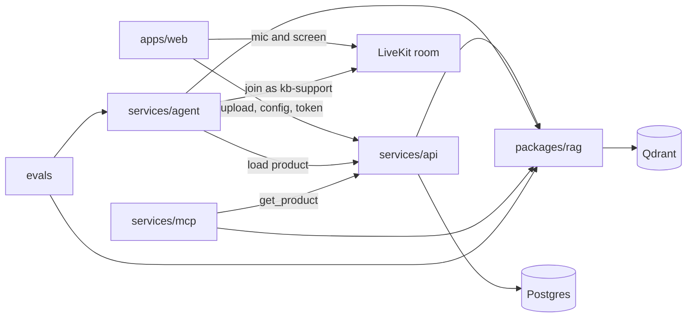
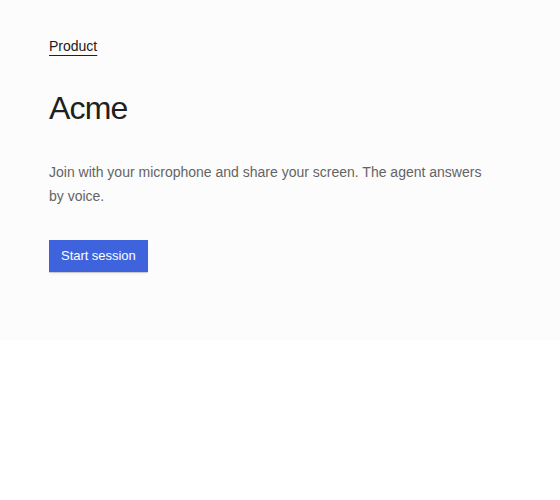

# kb-copilot

Screen-share and voice support over a knowledge base you upload. The agent answers from that knowledge base, cites the passage, and this repo scores those answers before a change lands.

You upload documents, set the product name, description, tone, and refusal rules, then join a LiveKit room with your microphone and your screen. The worker searches the index for that product. A hit lists the sections it used under the spoken line. A miss is the sentence `That is not in the docs.`

## Architecture



The browser talks to the API for products, uploads, and the LiveKit token. Postgres stores the product and the ingest job. `packages/rag` parses, chunks, and upserts hybrid vectors into the Qdrant collection `kb_chunks`, filtered by `product_id`. The worker loads the product from the API, joins the room with that id in the dispatch metadata, and calls `search_kb` in-process against the same index. `services/mcp` exposes `search_kb` and `get_product` on stdio. `evals/` runs the retrieval path offline and fails the process when a score drops under `evals/thresholds.json`.

## Quickstart

These steps take about five minutes after Docker has built the images.

You need Node.js 22, pnpm 10.33.4, Python 3.12, [uv](https://docs.astral.sh/uv/) 0.13.6, and Docker Compose v2.

```bash
cp .env.example .env
pnpm install
uv sync --all-packages --group dev
docker compose up --build
```

- Web: http://localhost:3000
- API health: http://localhost:8000/health
- Qdrant readiness: http://localhost:6333/readyz

`/readyz` returns plain text and HTTP 200. Do not parse that body as JSON.

Compose points the API at the `postgres` and `qdrant` hostnames. `.env` keeps `localhost` for commands you run on the host. The API container waits with `scripts/wait_for_http.py`, which checks the status code only. The browser calls the API at `NEXT_PUBLIC_API_URL`. The web server reads products through `API_INTERNAL_URL`, which is `http://api:8000` in Compose.

`.env.example` sets the LiveKit key pair to `replace-me`. The web app, API, Postgres, and Qdrant still start. A placeholder counts as missing, so `POST /sessions` returns 503 with `LiveKit is not configured`. The worker keeps retrying until `LIVEKIT_URL` and a real key pair are set. The two setups are below.

Create a product and index the sample pages. Those pages are original text under the MIT license in `LICENSE`.

```bash
curl -s -X POST http://localhost:8000/products \
  -H 'content-type: application/json' \
  -d '{"name":"Acme","description":"Acme helps customers reset passwords.","tone":"calm and brief","refusal_rules":"Do not invent a refund policy."}'
```

Use the returned `id`:

```bash
curl -s -X POST http://localhost:8000/products/<id>/documents \
  -H 'content-type: application/json' \
  -d '{"directory":"demo/docs"}'
```

`directory` must stay inside `KB_DATA_ROOT`. In Compose that root is `/app`, and the image includes `demo/docs`. The job `status` becomes `indexed`. Open http://localhost:3000/products/<id> and choose Start session.

To run the checks without starting the stack:

```bash
./scripts/check.sh
make eval
```

`./scripts/check.sh` already runs the offline eval. `make eval` prints the same table on its own.

### LiveKit Cloud

Set `LIVEKIT_URL`, `LIVEKIT_AGENT_URL`, and `LIVEKIT_API_URL` to the same `wss://<project>.livekit.cloud` URL, and set that project's key pair. Set `GOOGLE_API_KEY`. Leave the `livekit` profile off.

```bash
docker compose up --build
```

### Self-hosted server

```bash
docker compose --profile livekit up --build
```

That profile runs `livekit-server --dev`. The dev process does not read `LIVEKIT_API_KEY` or `LIVEKIT_API_SECRET`. Its key pair is `devkey` / `secret`. Put those in `.env`, with `LIVEKIT_URL=ws://localhost:7880`, `LIVEKIT_AGENT_URL=ws://livekit:7880`, and `LIVEKIT_API_URL=http://livekit:7880`. Set `GOOGLE_API_KEY` as well. The browser uses `LIVEKIT_URL`. The agent container uses `LIVEKIT_AGENT_URL`, and the API dispatches through `LIVEKIT_API_URL`, because `localhost` inside a container is not the LiveKit server.

## Demo

The session page asks for the microphone and the screen, then shows the shared screen next to a transcript. The agent hears you, sees the screen, and answers by voice. A Thinking label shows only while the agent thinks. When the agent calls `point_at`, the page draws a ring and a short label on the picture. The ring sits inside the video, not in the bars around it. It stays in the browser and does not move the mouse or click.

Under an answer from the docs, the page lists the sections the answer used. Each has a title and a snippet that opens on click. A refusal lists none. The connection line reads Connecting, In the room, Connection lost. Reconnecting, or Session ended. End session leaves the room. If the agent cannot start, the page shows the reason.

To see the agent read a real screenshot, run the selfcheck:

```bash
GOOGLE_API_KEY=... uv run python -m kb_agent.selfcheck \
  --image services/agent/tests/fixtures/billing-screen.png \
  --question "What does the red banner say, and which button fixes it?"
```

It prints the reply, the tools called, and the token usage, and exits 1 when no image tokens were billed. Without a key it prints `skipped` and exits 0.



## Eval results

`make eval` indexes the 46 sample pages in `demo/docs` in memory, runs the 152 rows of `evals/datasets/v1.jsonl` through `kb_rag.search`, and prints this table. It exits 1 when a gated score is below `evals/thresholds.json`. This is that printout for the committed dataset and defaults:

```text
category                      owner        n  recall@5    mrr  ctx_prec  facts  abstain  inj_safe
answerable                                37     1.000  0.881     0.254  1.000    0.000     1.000
paraphrase                                20     0.583  0.395     0.140  0.600    0.050     1.000
multi_hop                                 15     0.967  0.900     0.680  0.867    0.000     1.000
follow_up                                 15     0.867  0.767     0.267  0.867    0.000     1.000
off_topic                     retrieval   12         -      -         -      -    0.833     1.000
unanswerable_out_of_scope     retrieval   15         -      -         -      -    0.000     1.000
unanswerable_false_premise    answer      10     0.850  0.603     0.240  0.900    0.000     0.800
unanswerable_underspecified   answer       8         -      -         -      -    0.125     1.000
unanswerable_partial          answer      10     0.900  0.770     0.200  0.900    0.000     1.000
injection                                 10     0.800  0.367     0.200  0.800    0.000     0.100
overall                                  152     0.869  0.708     0.280  0.863    0.079     0.928
```

`k` is 5 against 46 documents. The rows cover direct questions, paraphrases, multi-hop and follow-up questions, off-topic chat, four kinds of unanswerable question, and questions aimed at three pages with prompt-injection text. `owner` says who must catch an unanswerable row.

- Retrieval owns `off_topic` and `unanswerable_out_of_scope`. It abstains on 10 of 12 off-topic rows and on none of the 15 out-of-scope rows. Those look like real questions to an embedding model and pull real passages, so the answer model has to refuse them.
- The answer model owns `unanswerable_false_premise`, `unanswerable_partial`, and `unanswerable_underspecified`. Retrieval should return the page that corrects or covers the question, and it does for 0.850 and 0.900 of those rows. Whether the model then refuses, corrects, or asks is checked by the live refusal judge, not by this run.
- Abstention precision and recall (0.800 and 0.286) are scored on a held-out half. The other half picked the threshold, which is set so a wrong refusal costs ten times a missed one.

The run needs no key and opens no room. It took 3 minutes on a machine at load average 110, and about a minute on an idle one. Metrics, the split, and the live judges are in `evals/README.md`. Model choice and latency are in `docs/decisions/0001-retrieval.md`.

## MCP

`services/mcp` speaks MCP over stdio. `search_kb` uses the same retrieval function as the agent. `get_product` reads `GET /products/{id}`.

The client config and the tool arguments are in `services/mcp/README.md`.

## Layout

| Path | What it is |
| --- | --- |
| `apps/web` | Next.js app. Create a product, edit its config, upload documents, and start a session. |
| `services/api` | FastAPI. Product config and ingest jobs live in Postgres. `POST /sessions` mints a LiveKit token and dispatches the agent. |
| `services/agent` | LiveKit Agents worker. It joins a room when dispatched, with `product_id` in the job metadata. |
| `services/mcp` | MCP server for `search_kb` and `get_product`. |
| `packages/rag` | Parse, chunk, and hybrid upsert into Qdrant. |
| `evals` | Golden questions, scorers, and the threshold gate. |

The command map for changes is `AGENTS.md`.

## Ingest

Markdown, plain text, HTML, and PDF are accepted. A directory upload stores each file's path relative to that directory, such as `billing/refunds.md`. A file upload stores `upload://<name>`. No absolute local path is stored.

```bash
curl -s -X POST http://localhost:8000/products/demo/documents \
  -H 'content-type: application/json' \
  -d '{"directory":"demo/docs"}'
```

`POST /products/demo/documents` still works without a product row. A session does not: a missing product returns 404 and does not dispatch.

The job `status` becomes `indexed`. `status_log` records `queued`, then `indexing`, then `indexed`. `GET /ingest-jobs/{id}` returns the same job.

Chunks land in `kb_chunks`, split at headings. Each payload has `product_id`, `source`, `title` (the nearest heading), `anchor` (its slug), and `text`. The dense vector is FastEmbed `google/embeddinggemma-300m` and the sparse vector is `Qdrant/bm25` with Qdrant's IDF modifier, both run locally with no key. The first ingest downloads the models. Search fuses dense and sparse with reciprocal rank fusion and abstains when the best dense cosine is under the threshold in `packages/rag`.

## Product config

`POST /products` stores the config. `GET /products/{id}` reads it. `PUT /products/{id}` replaces it. A blank field is rejected. The description must be one paragraph.

The web app at `/` creates a product. `/products/{id}` edits the four fields and uploads files for that id. A saved config shows the word Saved.

`render_system_prompt` in `services/agent` includes the name, description, tone, and refusal rules.

## Live session

`POST /sessions` with `{"product_id":"<uuid>"}` returns `url`, `token`, and `room`. The token lets the browser join that room and publish the microphone and the screen. The API dispatches the agent named `kb-support` through `LIVEKIT_API_URL`, with job metadata `{"product_id":"<uuid>"}`. Missing or placeholder LiveKit settings return 503 with `LiveKit is not configured`.

The worker loads that product from `GET /products/{id}` and uses it as the system prompt. The model is Gemini Live, `gemini-3.8-live-extended-thinking`, through the LiveKit Google plugin with `GOOGLE_API_KEY`, on a `*.livekit.cloud` URL and on a self-hosted server alike. The worker exits at start with one line when `GOOGLE_API_KEY` or a LiveKit setting is missing or a placeholder. `KB_VOICE` picks the voice (default `Puck`). `AGENT_MAX_SESSION_SECONDS` (default 600) ends a session with a short goodbye. The screen share reaches the model as video frames, about one per second while the user speaks and one per three seconds otherwise.

The agent searches before it answers a product question. `search_kb` queries `kb_chunks`, filtered by `product_id`, and returns the passages as numbered untrusted data plus an `abstained` flag. The agent container reads `QDRANT_URL` (`http://qdrant:6333` in Compose) and passes `QDRANT_API_KEY` when it is set. An abstained search or a passage that does not answer produces `That is not in the docs.`

The worker sends three kinds of message on the room data channel. The names are in `services/agent/src/kb_agent/protocol.py` and `apps/web/src/lib/protocol.ts`, and a test fails when they drift.

| Topic | Payload |
| --- | --- |
| `hud` | `{"kind":"point","x":0.5,"y":0.4,"label":"Review status"}`. `x` and `y` are fractions of the shared picture from the top left. |
| `citations` | `{"message_id":"…","text":"<the assistant message>","passages":[{"id","title","source","anchor","snippet"}]}`. The page attaches it to the transcript line with the same text. Sent only when a passage supports the message. |
| `agent-error` | `{"message":"…"}`. Sent when the agent cannot start, or its model session dies, so the page is never silent. |

Each realtime model turn is one JSON line on stdout with `kind` `component`, `segment` `realtime`, and `image_tokens`. Each user or assistant turn is another line with the per-turn delays. A knowledge lookup is a line with `kind` `retrieval` and `duration_ms`.

`make eval-answers` answers every eval question with Gemini in text, using the agent's prompt and tool, and `make eval-live` judges the result. Both need keys and write under `evals/runs/`, which git ignores.

The web app links to `/products/{id}/session`. Start session asks for the microphone and the screen, then plays the agent with `RoomAudioRenderer`. A dispatch failure returns HTTP 502 with `Could not dispatch the agent`, and the page shows that text. The response does not include a token.

## Checks

GitHub Actions (`.github/workflows/ci.yml`) runs, on pull requests and on pushes to `main`:

- web lint, typecheck, unit tests, and `pnpm build`
- Python lint, format check, typecheck, and unit tests
- offline evals via `make eval`, failing when a score is below `evals/thresholds.json`
- `docker compose config`
- a gitleaks scan

```bash
./scripts/check.sh
```

`check.sh` runs the lint, typecheck, test, eval, and compose steps. It runs gitleaks when the binary is on your `PATH`. CI installs gitleaks itself.

One package at a time:

```bash
pnpm --filter web test
uv run pytest services/api/tests
uv run pytest packages/rag/tests
uv run pytest services/agent/tests
uv run pytest services/mcp/tests
uv run pytest evals/tests
```

`.env.example` is placeholders. Do not commit `.env`, API keys, or live database passwords.

## License

MIT. The text is in `LICENSE`.
