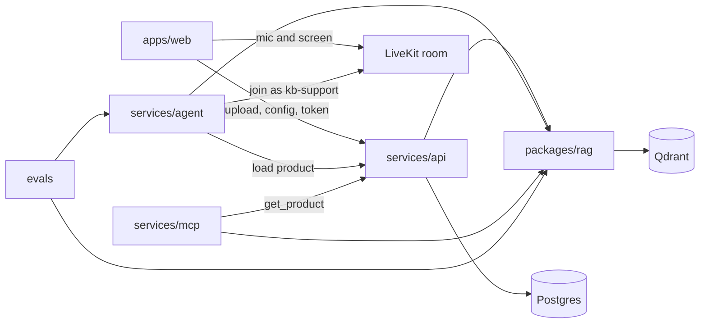
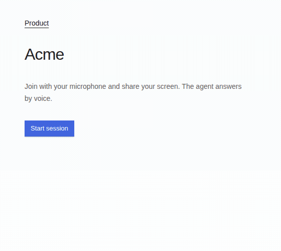
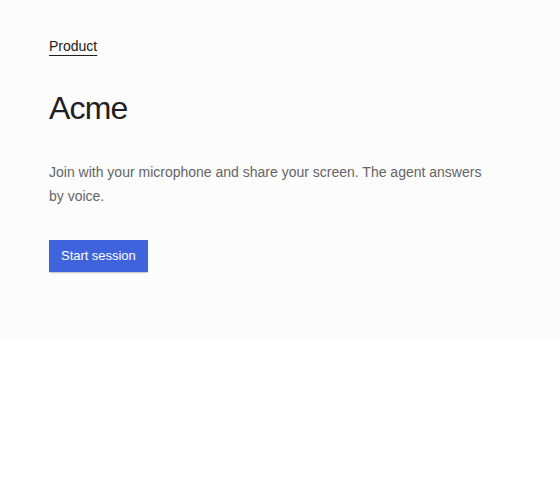
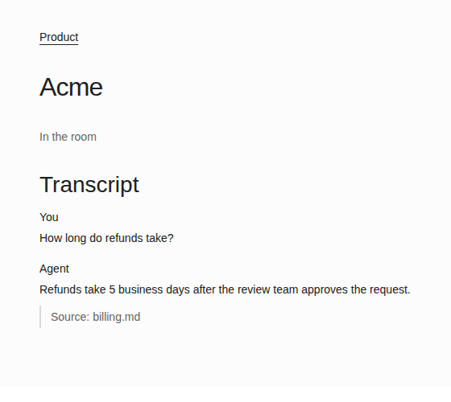

# kb-copilot

Screen-share and voice support over a knowledge base you upload. The agent answers from that knowledge base, cites the passage, and this repo scores those answers before a change lands.

You upload documents, set the product name, description, tone, and refusal rules, then join a LiveKit room with your microphone and your screen. The worker searches the index for that product. A hit shows up under the spoken line as `Source:`. A miss is the sentence `That is not in the docs.`

## Architecture



The browser talks to the API for products, uploads, and the LiveKit token. Postgres stores the product and the ingest job. `packages/rag` parses, chunks, and upserts hybrid vectors into the Qdrant collection `kb_chunks`, filtered by `product_id`. The worker loads the product from the API, joins the room with that id in the dispatch metadata, and calls `search_kb` in-process against the same index. `services/mcp` exposes `search_kb` and `get_product` on stdio. `evals/` runs the retrieval path offline and fails the process when a score drops under `evals/thresholds.json`.

## Quickstart

These steps take about five minutes after Docker has built the images.

You need Node.js 22, pnpm 10.33.4, Python 3.12, [uv](https://docs.astral.sh/uv/) 0.13.6, and Docker Compose v2.

```bash
cp .env.example .env
pnpm install
uv sync --all-packages --group dev
docker compose up --build
```

- Web: http://localhost:3000
- API health: http://localhost:8000/health
- Qdrant readiness: http://localhost:6333/readyz

`/readyz` returns plain text and HTTP 200. Do not parse that body as JSON.

Compose points the API at the `postgres` and `qdrant` hostnames. `.env` keeps `localhost` for commands you run on the host. The API container waits with `scripts/wait_for_http.py`, which checks the status code only.

`.env.example` sets the LiveKit key pair to `replace-me`. The web app, API, Postgres, and Qdrant still start. The worker joins a room only after `LIVEKIT_URL` and a real key pair are set. It exits when either value is missing. On a `*.livekit.cloud` URL, LiveKit Inference uses that key pair and `OPENAI_API_KEY` can stay empty. On any other URL, spoken replies need `OPENAI_API_KEY`. The two setups are below.

Create a product and index the sample pages. Those pages are original text under the MIT license in `LICENSE`.

```bash
curl -s -X POST http://localhost:8000/products \
  -H 'content-type: application/json' \
  -d '{"name":"Acme","description":"Acme helps customers reset passwords.","tone":"calm and brief","refusal_rules":"Do not invent a refund policy."}'
```

Use the returned `id`:

```bash
curl -s -X POST http://localhost:8000/products/<id>/documents \
  -H 'content-type: application/json' \
  -d '{"directory":"demo/docs"}'
```

`directory` must stay inside `KB_DATA_ROOT`. In Compose that root is `/app`, and the image includes `demo/docs`. The job `status` becomes `indexed`. Open http://localhost:3000/products/<id> and choose Start session.

To run the checks without starting the stack:

```bash
./scripts/check.sh
make eval
```

`./scripts/check.sh` already runs the offline eval. `make eval` prints the same table on its own.

### LiveKit Cloud

Set `LIVEKIT_URL` and `LIVEKIT_AGENT_URL` to the same `wss://<project>.livekit.cloud` URL, and set that project's key pair. Leave `OPENAI_API_KEY` empty. The worker uses LiveKit Inference on a `*.livekit.cloud` host. Leave the `livekit` profile off.

```bash
docker compose up --build
```

### Self-hosted server

```bash
docker compose --profile livekit up --build
```

That profile runs `livekit-server --dev`. The dev process does not read `LIVEKIT_API_KEY` or `LIVEKIT_API_SECRET`. Its key pair is `devkey` / `secret`. Put those in `.env`, with `LIVEKIT_URL=ws://localhost:7880` and `LIVEKIT_AGENT_URL=ws://livekit:7880`. Set `OPENAI_API_KEY` as well. The browser uses `LIVEKIT_URL`. The agent container uses `LIVEKIT_AGENT_URL` because `localhost` inside that container is not the LiveKit server.

## Demo

The session page asks for the microphone and the screen. After the room connects, the shared picture is shown on the page. While the agent thinks, a Thinking label appears on that picture. When the agent calls `point_at`, a ring and a short label mark a spot. That highlight is drawn in the browser, on the preview. It is not an operating-system cursor. The worker does not move the mouse, and it does not click. The frames sent to the model are the shared screen without that highlight.

The transcript lists each turn. A cited answer shows `Source:` under the agent's line. The label is the file name, here `billing.md`.



The stills below are the session components with a sample turn, so the citation stays readable. They are component frames, not a recording of a Cloud room.

One Cloud session recorded the live page. The preview showed the shared refund page. The caller asked how long refunds take and which button to press. The transcript answered with the indexed sentence, "Refunds take 5 business days after the review team approves the request.", and the line under it was `Source: billing.md`. That reply also asked the caller to share the screen. The realtime usage for the turn reported `image_tokens` as 0. The capture shows the citation. It does not show the model using the picture. `point_at` was not called, so no ring was drawn. The sentence under the preview still says the highlight does not move the mouse. A later plugin room shared that same page and closed before a reply. Its realtime lines stayed at `image_tokens` 0.





What you would hear for "How long do refunds take?": the indexed sentence is "Refunds take 5 business days after the review team approves the request." On LiveKit Cloud the worker speaks with Gemini Live. The transcript adds `Source: billing.md`. The system prompt tells the agent not to read the source URL aloud.

A Cloud room needs `LIVEKIT_URL` on `*.livekit.cloud` and that project's key pair. `OPENAI_API_KEY` can stay empty on that host.

What to say about this repo is in [Interview talking points](#interview-talking-points).

## Interview talking points

- Upload the product docs, set the refusal rules, and join a call with your microphone and your screen. The agent answers by voice from those docs.
- When the docs contain the answer, the transcript shows `Source:` and the file name, as in `Source: billing.md`. When they do not, the agent says `That is not in the docs.`
- `make eval` scores the 40 sample questions with no model key and no LiveKit room. It checks that the right page was found and that the answer cites it. Faithfulness is a text overlap check against the retrieved passage, described in `evals/README.md`. It is not a live model judging its own answer. The command fails when a score drops under `evals/thresholds.json`.

## Eval results

`make eval` indexes `demo/docs` in memory, answers the 40 rows in `evals/datasets/demo.jsonl`, and prints this table. The command exits 1 when a score is below the threshold. These numbers are that printout for the committed dataset.

| Metric | Score | Threshold |
| --- | --- | --- |
| hit@5 | 1.000 | 1.000 |
| mrr | 1.000 | 1.000 |
| citation_rate | 1.000 | 1.000 |
| faithfulness | 1.000 | 1.000 |

`k` is 5, from `evals/thresholds.json`. Hit rate, MRR, citation rate, and faithfulness are defined in `evals/README.md`. The run does not call a paid model and does not open a room. When retrieval returns a passage, the scored text is the dataset `answer` plus the same `Source:` suffix the transcript uses. When it returns nothing, the text is `That is not in the docs.` Faithfulness asks whether those sentences appear in the retrieved passage. It does not ask a model whether a spoken answer was faithful.

## MCP

`services/mcp` speaks MCP over stdio. `search_kb` uses the same retrieval function as the agent. `get_product` reads `GET /products/{id}`.

Start the stack from the quickstart, then point the client at this repo. Stdout is the protocol. The longer notes, including the tool arguments, are in `services/mcp/README.md`.

```json
{
  "mcpServers": {
    "kb-copilot": {
      "command": "uv",
      "args": [
        "run",
        "--directory",
        "/absolute/path/to/kb-copilot",
        "--package",
        "kb-mcp",
        "kb-mcp"
      ],
      "env": {
        "QDRANT_URL": "http://localhost:6333",
        "API_URL": "http://localhost:8000"
      }
    }
  }
}
```

## Layout

| Path | What it is |
| --- | --- |
| `apps/web` | Next.js app. Create a product, edit its config, upload documents, and start a session. |
| `services/api` | FastAPI. Product config and ingest jobs live in Postgres. `POST /sessions` mints a LiveKit token and dispatches the agent. |
| `services/agent` | LiveKit Agents worker. It joins a room when dispatched, with `product_id` in the job metadata. |
| `services/mcp` | MCP server for `search_kb` and `get_product`. |
| `packages/rag` | Parse, chunk, and hybrid upsert into Qdrant. |
| `evals` | Golden questions, scorers, and the threshold gate. |

The command map for changes is `AGENTS.md`. The hiring-theme checklist is `docs/jd-fit.md`.

## Ingest

Markdown, HTML, and PDF are accepted. A file upload uses `upload://<name>` as `source_url`. A directory upload uses the file URI.

```bash
curl -s -X POST http://localhost:8000/products/demo/documents \
  -H 'content-type: application/json' \
  -d '{"directory":"demo/docs"}'
```

`POST /products/demo/documents` still works without a product row. A session does not: a missing product returns 404 and does not dispatch.

The job `status` becomes `indexed`. `status_log` records `queued`, then `indexing`, then `indexed`. `GET /ingest-jobs/{id}` returns the same job.

Chunks land in `kb_chunks`. Each payload has `product_id`, `source_url`, and `text`. The dense vector is a local hash, so indexing needs no model key. The sparse vector stores term counts, and Qdrant applies an IDF modifier. Hybrid search fuses the two with reciprocal rank fusion.

## Product config

`POST /products` stores the config. `GET /products/{id}` reads it. `PUT /products/{id}` replaces it. A blank field is rejected. The description must be one paragraph.

The web app at `/` creates a product. `/products/{id}` edits the four fields and uploads files for that id. A saved config shows the word Saved.

`render_system_prompt` in `services/agent` includes the name, description, tone, and refusal rules.

## Live session

`POST /sessions` with `{"product_id":"<uuid>"}` returns `url`, `token`, and `room`. The token lets the browser join that room and publish the microphone and the screen. The API dispatches the agent named `kb-support` with job metadata `{"product_id":"<uuid>"}`. Missing LiveKit settings return 503.

The worker loads that product from `GET /products/{id}` and uses it as the system prompt. On a `*.livekit.cloud` URL it uses LiveKit Inference. The realtime model is `google/gemini-3.8-live-extended-thinking` with voice `Puck` and reasoning effort `low`. If that session fails to start, the worker tries `google/gemini-3.8-live`, then `google/gemini-live`. `google/gemini-live` is an alias of `google/gemini-3.8-live`. The worker samples screen-share frames, about one a second while the caller speaks and about one every three seconds otherwise. That Inference session sends each frame as an OpenAI `input_image` item. Gemini Live counts a picture when the frame arrives as a video blob, which is what the Gemini plugin sends. A Cloud Inference room answered from the docs and reported `image_tokens` 0, `input_tokens` 11965, and `output_tokens` 925. A later Cloud room used that plugin with one socket (`max_retry` 0) and server activity detection left on. The screen share subscribed. The greeting logged `generate_reply timed out waiting for generation_created event`. The socket then closed with `1008 None. BidiGenerateContent session is already connected to an existing client`. The realtime lines before the close were `image_tokens` 0, `input_tokens` 0, `output_tokens` 0, and `duration_ms` 0. That room did not finish a vision turn. `OPENAI_API_KEY` can stay empty. On any other URL, including the Compose hostname `livekit`, the worker uses the OpenAI plugin and `OPENAI_API_KEY`. That pipeline does not receive the frames. A local media server is not required for the Cloud path, and this repo does not ask you to run one for a Cloud session.

Each product question calls `search_kb` against `kb_chunks`, filtered by `product_id`. The agent container reads `QDRANT_URL` (`http://qdrant:6333` in Compose). The API and the worker pass `QDRANT_API_KEY` when it is set. An empty value leaves local Qdrant without a key. A matching passage is cited in the transcript. No matching passage produces `That is not in the docs.` On the Cloud path that sentence is spoken by the Inference TTS. The realtime model is not asked to invent a replacement.

`point_at` publishes a JSON message on the `hud` topic. The session page draws it on the shared-screen preview. The same page shows Thinking while the agent state is thinking. Neither mark leaves the browser.

The worker subscribes to screen-share video when the browser publishes one. Each STT, LLM, TTS, or realtime metric is one JSON line on stdout, and each user or assistant turn is another JSON line with the per-turn delays. A realtime line includes `image_tokens` when the model reports them. A knowledge lookup is another JSON line with `kind` set to `retrieval` and `duration_ms`.

The web app links to `/products/{id}/session`. Start session asks for the microphone and the screen, then plays the agent with `RoomAudioRenderer`. A dispatch failure returns HTTP 502 with `Could not dispatch the agent`, and the page shows that text. The response does not include a token.

## Checks

GitHub Actions (`.github/workflows/ci.yml`) runs, on pull requests and on pushes to `main`:

- web lint, typecheck, unit tests, and `pnpm build`
- Python lint, format check, typecheck, and unit tests
- offline evals via `make eval`, failing when a score is below `evals/thresholds.json`
- `docker compose config`
- a gitleaks scan

```bash
./scripts/check.sh
```

`check.sh` runs the lint, typecheck, test, eval, and compose steps. It runs gitleaks when the binary is on your `PATH`. CI installs gitleaks itself.

One package at a time:

```bash
pnpm --filter web test
uv run pytest services/api/tests
uv run pytest packages/rag/tests
uv run pytest services/agent/tests
uv run pytest services/mcp/tests
uv run pytest evals/tests
```

`.env.example` is placeholders. Do not commit `.env`, API keys, or live database passwords.

## License

MIT. The text is in `LICENSE`.
