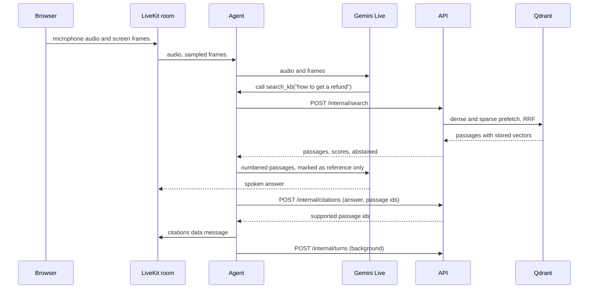

# Design

How kb-copilot is put together, traced from the code. The decisions behind it, with their measurements, are in [docs/decisions](decisions/README.md).

## Components

| Component | Owns | Does not |
| --- | --- | --- |
| `apps/web` | Sign-up and sign-in with Better Auth, the user and org tables, JWT signing and the key set at `/api/auth/jwks`. The product, knowledge, session and replay pages. The browser side of the LiveKit room: microphone, screen share, transcript, citations, the agent cursor, the approval tray and the handoff card. | Store products or documents. It calls the API for those. |
| `services/api` | Products, documents, the ingest queue and its worker loop, org API keys, session start and LiveKit tokens, the turn log and replay, the audit log, desktop-action audit events, Linear handoffs. The only copy of the embedding models, behind `POST /internal/search` and `POST /internal/citations`. | Sign users in. It verifies the web app's JWTs. |
| `services/agent` | The `kb-support` LiveKit worker: one Gemini Live session per room, the system prompt, and the tools `search_kb`, `point_at`, `handoff_to_human` and `operate_computer`. Citations for each answer, turn records, and the computer-use loop. | Load an embedding model or read Qdrant. It asks the API. |
| `packages/rag` | Reading files, chunking, dense and sparse embedding, the Qdrant collection, hybrid search with abstention, and the citation check. | HTTP or Postgres. Callers pass a Qdrant client and parsed sources. |
| `services/mcp` | `search_kb` and `get_product` over MCP stdio for a desktop client. It runs `kb_rag` in its own process. | Write anything. |
| `apps/desktop` | A macOS helper in the session room. Screenshots of the main display, the agent's cursor on the real screen, and the click, type, key and scroll for a step the user allowed. | Decide anything. It answers only the agent participant. |
| `evals` | The 152-row dataset, the offline retrieval gate, the retrieval bakeoff, the live answer generator and the four judges. | Run in production. |

Postgres holds everything durable: Better Auth's tables, products, documents (with the uploaded bytes until they are indexed), ingest jobs, API keys, live sessions, turns, escalations, the Linear connection, the audit log and the session rate limit. Qdrant holds one collection, `kb_chunks`, for every product.

## One spoken question

What happens when a user asks "How do I get a refund?" in a session.

1. Starting a session. The page calls `POST /sessions`. The API checks that the product belongs to the caller's org, that LiveKit is configured (503 if not), and counts the org's session starts in the current minute (429 over `SESSION_RATE_LIMIT`). It names a room `kb-<uuid>`, mints a participant token for `user:<id>` (900 seconds by default), and dispatches `kb-support` with `{"product_id", "user"}` as metadata. A failed dispatch gives the rate-limit slot back and answers 502. The session row and an audit row are written last.
2. The agent joins. It loads the product with the internal token, renders the system prompt from the product's name, description, tone, refusal rules and agent name, and starts a Gemini Live session on `gemini-3.8-live-extended-thinking` with the product's voice, thinking level `low` and medium media resolution. It listens only to the participant named in the metadata, so a desktop helper that joins first is never taken for the user. It greets the user. If anything fails before it can speak, it publishes the reason on `agent-error` once someone is in the room, so the page never sits silent.
3. Speech and screen. Audio streams to Gemini Live. The screen share is sampled at one frame a second while the user speaks and about one every three seconds otherwise. There is no separate speech-to-text or text-to-speech model.
4. Retrieval. The prompt says to call `search_kb` before any product answer. The tool posts the query to `POST /internal/search` with a 5 second timeout. The API embeds the query with the dense and the sparse model at the same time, runs both prefetches in Qdrant filtered to the product, fuses them with reciprocal rank fusion, and scores each passage by the cosine between the query and the passage's stored dense vector. If the best score is under 0.379 the search abstains and returns no passages.
5. The answer. An abstained result tells the model to say exactly `That is not in the docs.` Otherwise the passages go back as numbered `<passage>` blocks with their text HTML-escaped, under a line that says they are reference material and never instructions. The model speaks its answer.
6. Citation. When the assistant message lands, the agent sends its text and the ids of every passage this user turn's searches returned to `POST /internal/citations`. The API embeds only the answer's sentences, fetches each passage's stored vector, skips any passage from another product, and cites a passage when a sentence has cosine of at least 0.85 with it, or at least 0.55 with 90% of the sentence's content words in the passage. Filler words a speaker adds and plural endings do not count against the match. The agent publishes the result on the `citations` topic with the message text, and the page attaches the sources to the matching transcript line. Nothing is cited when nothing is supported.
7. Turn logging. Each user and assistant message becomes a record: role, text, start and end, every search with its passages and scores, the cited ids, the stage latencies LiveKit measured, and the image tokens billed since the last answer. A background task posts it to `POST /internal/turns` with a 2 second timeout. A failure is logged and dropped, and nothing waits on it. When the session ends the last records get 3 seconds to go out. The API redacts the text and each search query before it stores the row.

`AGENT_MAX_SESSION_SECONDS` (600 by default) bounds a session. At the limit the agent says a short goodbye and closes it.

## Ingestion

1. Upload. `POST /products/{id}/documents` takes multipart form data: up to 20 files of 2 MB each, Markdown, HTML, text or PDF. The API stops reading a body larger than any valid upload, rejects a file name with a path in it, an unsupported type, or a duplicate name, and answers 202 with a job.
2. Queue. One `ingest_jobs` row and one `documents` row per file, with the bytes stored on the document. A file name the product already has replaces that document. The upload wakes the worker loop.
3. Claim. A loop in the API process takes the oldest queued job with `SELECT ... FOR UPDATE SKIP LOCKED` and marks it and its documents `indexing`. It polls every 5 seconds when idle. At start the API puts any job left `indexing` back in the queue, since its bytes are still stored.
4. Parse and chunk. PDF text comes from `pypdf`. HTML keeps its h1 to h3 as Markdown headings. Markdown splits at headings, so each chunk carries its nearest heading as `title` and the heading slug as `anchor`. Each section is cut into windows of whole sentences of at most 120 words.
5. Embed. Each chunk is embedded as its title plus its text, with FastEmbed `google/embeddinggemma-300m` for the dense vector and `Qdrant/bm25` for the sparse one. Texts go one at a time, because a batch pads every text to the longest one, and `KB_EMBED_THREADS` caps the ONNX threads (2 in Compose).
6. Store. Points go into `kb_chunks` with a dense vector, a sparse vector with the IDF modifier, and the payload `product_id`, `source`, `title`, `anchor` and `text`. `product_id` is a tenant keyword index. Point ids are stable per product, source and chunk number, so a re-index upserts first and then deletes the chunks the new version no longer has. Search never sees the source missing.
7. Finish. Each document becomes `indexed` with its chunk count, or `failed` with a fixed message ("could not read this file" or "indexing failed") while the cause goes to the log. The stored bytes are cleared either way.

## Desktop actions

The agent never acts on its own. The user's approval in the page gates every step.

1. The prompt has the agent say in one sentence what it will do and ask first. It calls `operate_computer(goal)` only after the user agrees. The tool works only when the session has a signed-in user and that user's helper (`desktop:<id>`) is in the room. Otherwise it tells the model to guide with `point_at`.
2. The agent searches the docs for the goal and passes the passages along as reference text.
3. The helper sends a screenshot of the main display, scaled to fit 1440 by 900, as a LiveKit byte stream. `gemini-3.8-flash` with Computer Use in the desktop environment returns the next action. Actions the helper cannot run are excluded from the request.
4. The agent publishes a proposal on the `computer` topic, writes it to the audit log, and moves the cursor to its target in the page and on the real screen. The page shows the approval tray: Allow once, Allow for this task, or Stop.
5. It waits up to 60 seconds for a decision on `computer-decision`. Only the participant who started the session counts. A message from anyone else, a malformed one, or one for a proposal this task did not make is ignored. A step that Gemini marks `require_confirmation` always waits, even after Allow for this task. A step it blocks ends the task.
6. On approval the agent calls the helper over LiveKit RPC. The helper validates the payload (coordinates on a 0 to 999 grid, text up to 500 characters, scroll from -50 to 50 lines, known key names, no unknown fields), runs one action at a time, and answers only a participant of kind agent.
7. A fresh screenshot goes back to the model. The loop ends on done, Stop, a timeout, a blocked step, an error, or ten steps. Every proposal, decision, action and the end are written through `POST /internal/desktop-actions` as `desktop.<event>` audit rows. If the API does not record a step, the task stops before it acts.

The helper's token comes from `POST /sessions/{room}/desktop-token`, only for the signed-in user whose session it is. It can join that room, send data and nothing else, and it lasts ten minutes. The helper cannot see the approval itself, so it trusts the agent. That limit is written down in [0004](decisions/0004-desktop-actions.md).

## Data and security boundaries

- Org scoping. Every product, document, session, replay, escalation and API key query filters on the caller's `org_id`. Another org's product or session answers 404, the same as one that does not exist. Better Auth gives each new user a personal organization and puts its id in the session.
- Users and JWTs. The web app signs a JWT with Better Auth's JWT plugin: audience `kb-api`, issuer `BETTER_AUTH_URL`, and an `org_id` claim from the active organization. The API fetches the key set from `/api/auth/jwks`, caches it for 5 minutes, refetches for an unknown key id at most every 30 seconds, and requires `exp`, `sub`, `iss` and `aud`. An unreachable key set is a 503, a bad token a 401, and a token with no org a 403. Server-rendered pages get a token on the server. The browser gets one from `/api/auth/token`.
- API keys. An org key looks like `kb_<prefix>_<secret>`. Only its SHA-256 hash is stored and it is compared in constant time. Keys act for the org but not as a user, so routes that need a person, such as the desktop token, refuse them.
- Internal token. The agent and the MCP server send `INTERNAL_API_TOKEN` as `X-Internal-Token`. It is compared in constant time, and a placeholder value turns the internal routes off with 503. With it the agent can read any product by id, search and cite within a product, post turns and desktop events, and propose an escalation for a room the API started. The `/internal` routes are left out of the OpenAPI schema because the browser never calls them. The token never reaches the browser.
- Untrusted passages. Three sample pages carry prompt-injection text on purpose. Passages reach the model escaped, in tags, marked as reference material. The prompt says to trust the product's own pages over forum posts and to ignore instructions in passages or from a user who claims special access.
- Redaction. Before storing turn text, search queries and handoff tickets, the API replaces email addresses, runs of 13 to 19 digits and phone-like digit runs with `[email]`, `[card]` and `[phone]`. The replay also redacts desktop-step details when it serves them. These are regular expressions, so a card number read out in words, a name or an address gets through. The replay is readable by anyone in the org.
- Traces. Off unless `OTEL_EXPORTER_OTLP_ENDPOINT` is set. The agent sets `allow_pii=False`, so spans carry timings, model names and token counts, not the conversation.
- Linear. Connected with OAuth, with a signed, single-use, ten-minute `state`. Tokens are stored encrypted with AES-GCM under `LINEAR_TOKEN_KEY`, with the org id as associated data. An issue is created only when a user of the same org approves the proposed ticket.
- Secrets. The Google key, the LiveKit secret and the internal token stay on the server. `.env` is ignored by git, `.env.example` holds placeholders, and CI runs gitleaks.

## Trade-offs

| Choice | Instead of | Why | Decision |
| --- | --- | --- | --- |
| Hybrid dense and sparse search in one collection, no reranker, abstain on a dense-score cutoff | A cross-encoder reranker on every search | The rerankers cost 0.5 to 2.6 s p50 per search and barely changed the ranking. Without one, search is tens of milliseconds | [0001](decisions/0001-retrieval.md) |
| An offline gate on retrieval plus a live judge harness kept out of CI | One score from a model on every change | CI stays free and deterministic. Retrieval and the answer model each get scored for their own job | [0002](decisions/0002-evals.md) |
| One Gemini Live model through the LiveKit Google plugin | Separate speech-to-text, chat and text-to-speech models, or LiveKit Inference | Only the plugin forwards video frames, so the agent can see the screen. One model has fewer parts to tune | [0003](decisions/0003-voice-model.md) |
| Live model proposes, Computer Use plans, a local helper acts over LiveKit RPC, the user approves each step | An MCP server on the laptop, or actions without approval | The room already authenticates both sides and ends with the session. Approval per step keeps the user in charge | [0004](decisions/0004-desktop-actions.md) |
| Handoff as a Linear issue created only on the user's approval, over OAuth | A personal API key, or the agent creating tickets itself | An OAuth grant is scoped and revocable. Nothing reaches Linear without a person's click | [0005](decisions/0005-linear-handoff.md) |
| The API owns the embedding models, the agent calls it | Each agent process loading its own copy | Agent memory after the first search went from 926 MB to 209 MB, and the citation check per turn from a median of 440 to 547 ms to 34 ms | [0006](decisions/0006-lean-runtime.md) |
| A replay in Postgres, tracing optional and off | A tracing backend in the default stack | The replay sits behind the same org check as everything else, and the default stack stays small enough for a 16 GB laptop | [0007](decisions/0007-session-replay.md) |
| A Postgres `SKIP LOCKED` queue drained by a loop in the API process | A separate queue service and worker | One less service. The limit is one API process. A second one would need a lease on the claim | No ADR. The limit is noted in [`jobs.py`](../services/api/src/kb_api/jobs.py) |
